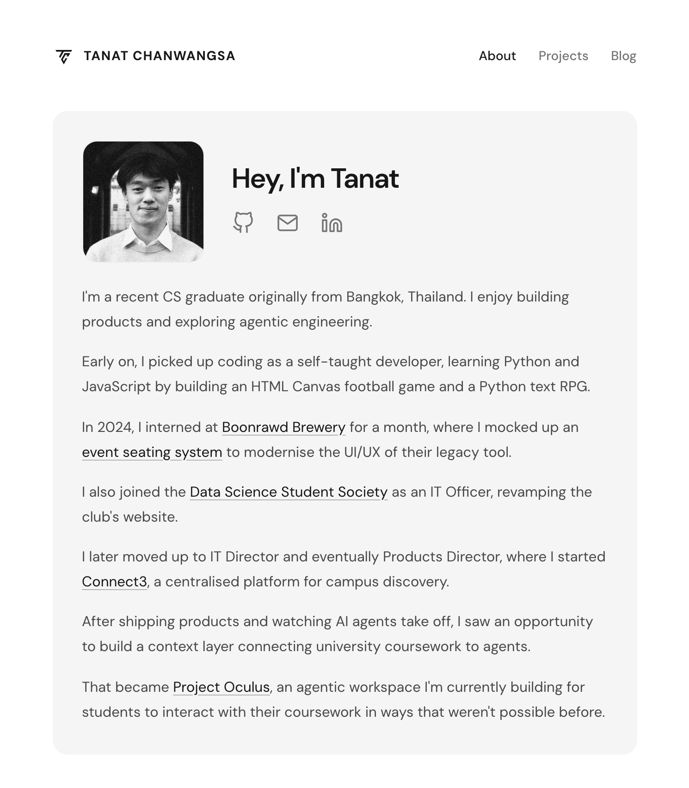
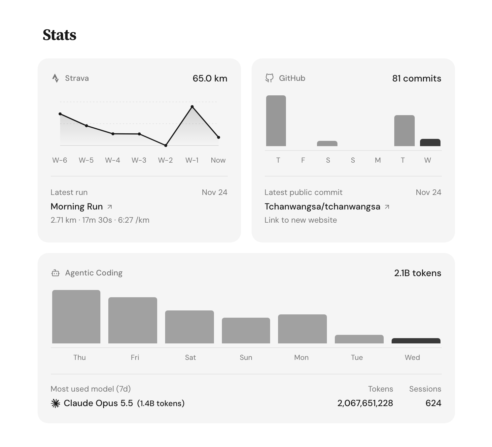

<div align="center">

<picture>
  <source media="(prefers-color-scheme: dark)" srcset=".github/assets/banner-dark.svg">
  
</picture>

<p>
  <a href="https://tchanwangsa.xyz"><strong>Visit the site</strong></a>
  &nbsp;·&nbsp;
  <a href="#run-it"><strong>Run it</strong></a>
  &nbsp;·&nbsp;
  <a href="https://github.com/Tchanwangsa/portfolio-api"><strong>Stats API</strong></a>
</p>

<p>
  <a href="https://www.solidjs.com/"></a>&nbsp;
  <a href="https://www.typescriptlang.org/"></a>&nbsp;
  <a href="https://tailwindcss.com/"></a>&nbsp;
  <a href="https://vite.dev/"></a>&nbsp;
  <a href="https://vercel.com/"></a>
</p>

</div>

## About

My personal site at [tchanwangsa.xyz](https://tchanwangsa.xyz): who I am, what I'm building, my projects and my blog. It's a static SolidJS app with no backend of its own.

<picture>
  <source media="(prefers-color-scheme: dark)" srcset=".github/assets/home-dark.png">
  
</picture>

## Live stats

The About page ends with three cards that update on every visit, read from [portfolio-api](https://github.com/Tchanwangsa/portfolio-api):

- **Strava**: kilometres run each week over the last seven weeks, and the latest run
- **GitHub**: commits per day over the last week, private repositories included, and the latest public commit
- **Agentic coding**: tokens per day across my coding agents, with the session count and the most used model

<picture>
  <source media="(prefers-color-scheme: dark)" srcset=".github/assets/stats-dark.png">
  
</picture>

Days and weeks follow the visitor's own time zone. Each card shows a skeleton while it loads. If the API is unreachable, the Strava and GitHub cards say so, and the agentic coding card stays hidden.

## Run it

You'll need [Node.js](https://nodejs.org).

```sh
npm install
npm run dev          # http://localhost:3000
npm run typecheck
```

In development the cards read the live API, so there is nothing else to run. To point them at a local copy of the API, start it from [portfolio-api](https://github.com/Tchanwangsa/portfolio-api) and run `VITE_API_URL=http://127.0.0.1:8787 npm run dev`.

## Where things live

| Path | Contents |
| --- | --- |
| `src/content/about.md` | About page copy |
| `src/data/projects.ts`, `src/data/blogs.ts` | Projects and blog posts |
| `src/data/stats.ts` | Stats API client and the grouping into local days and weeks |
| `src/components/`, `src/pages/` | UI |

## Deploy

Pushing to `main` deploys to Vercel.
